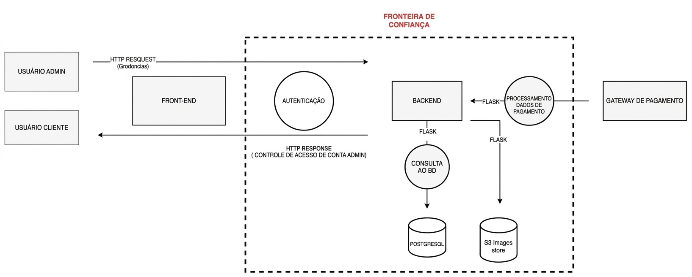

# 1. Cenário, arquitetura e fluxo de dados

## 1.1 Contexto

A ShopFlow é uma startup fictícia de comércio eletrônico que está desenvolvendo uma plataforma web. A aplicação permitirá que clientes criem contas, realizem login, consultem produtos, adicionem itens ao carrinho, finalizem pedidos, paguem por meio de um gateway externo e acompanhem o histórico e o status de suas compras.

Também existe um perfil administrativo com permissões para consultar pedidos de diferentes clientes e realizar operações administrativas, como alterar status de pedidos e informações de produtos.

O objetivo desta etapa é compreender o sistema antes de avaliar ameaças: identificar seus componentes, ativos, fluxos de dados e fronteiras de confiança.

## 1.2 Componentes identificados

| Componente | Tecnologia / função | Observações |
|---|---|---|
| Front-end | React | Executado no navegador do usuário |
| Back-end | Python / Flask | Recebe requisições e aplica regras de negócio |
| Banco de dados | PostgreSQL | Armazena contas, produtos, pedidos e status |
| Hospedagem | AWS | Ambiente de infraestrutura considerado no cenário |
| Autenticação | Login e senha + JWT | JWT é utilizado para identificar usuários autenticados |
| Pagamentos | API de gateway externo | Serviço de terceiro que processa pagamentos |
| Repositório | GitHub | Utilizado pelos desenvolvedores |
| Comunicação | HTTPS / REST API | Comunicação entre cliente e aplicação |
| Armazenamento de imagens | Amazon S3 | Considerado no levantamento inicial |
| Logs | Registros da aplicação | Existem registros, mas não há política formal de retenção e monitoramento descrita |

## 1.3 Entidades externas

- **Cliente:** utiliza a aplicação para consultar produtos, gerenciar sua conta, realizar compras e acompanhar seus próprios pedidos.
- **Administrador:** utiliza funcionalidades privilegiadas para consultar pedidos de diferentes clientes e executar operações administrativas.
- **Gateway de pagamento:** serviço externo responsável pelo processamento de pagamentos e pelo envio de notificações de aprovação ou rejeição.

Cliente e administrador são tratados como entidades distintas porque possuem níveis de autorização diferentes, mesmo que possam utilizar a mesma aplicação web.

## 1.4 Processos principais

- Autenticação de usuários.
- Consulta do catálogo de produtos.
- Gerenciamento do carrinho.
- Checkout e iniciação de pagamentos.
- Recebimento e tratamento do resultado do pagamento.
- Consulta e atualização do perfil do cliente.
- Consulta do histórico e status de pedidos.
- Consulta e alteração de pedidos por administradores.
- Gerenciamento administrativo de produtos e preços.
- Registro de eventos e operações em logs.

## 1.5 Depósitos de dados

- **PostgreSQL:** contas, dados de produtos, pedidos e status.
- **Amazon S3:** imagens dos produtos.
- **Logs da aplicação:** eventos e operações registrados pelo sistema.

O enunciado informa que existem logs, mas não detalha formato, proteção contra adulteração, retenção, centralização ou monitoramento. Esses pontos são tratados como lacunas a investigar, não como controles necessariamente inexistentes.

## 1.6 Fluxos de dados relevantes

| Origem | Destino | Dados / finalidade |
|---|---|---|
| Cliente / navegador | Aplicação | Credenciais e dados de cadastro |
| Aplicação / back-end | PostgreSQL | Dados de conta, produtos e pedidos |
| Back-end | Gateway de pagamento | Dados necessários para iniciar o pagamento |
| Gateway de pagamento | Back-end | Resultado e status do pagamento, incluindo notificações |
| Back-end | Amazon S3 | Operações relacionadas às imagens dos produtos |
| Back-end | Logs | Eventos e operações relevantes para rastreabilidade |

Os fluxos representam uma visão lógica. A implementação exata, os campos transmitidos e os mecanismos de autenticação entre serviços precisariam ser confirmados com a equipe de desenvolvimento.

## 1.7 Fronteiras de confiança

1. **Navegador / React → back-end Flask:** o navegador e o código executado no cliente estão sob controle do usuário. Dados enviados pelo front-end não devem ser considerados confiáveis. O back-end deve validar entradas, autenticar a identidade e autorizar cada operação.
2. **Back-end → gateway externo:** o gateway é um terceiro, fora da fronteira de confiança da ShopFlow. A integração deve validar respostas e notificações recebidas, incluindo autenticidade e integridade dos webhooks.
3. **Back-end → PostgreSQL / S3:** são serviços de infraestrutura utilizados pela aplicação. O modelo assume que pertencem ao domínio operacional da ShopFlow, mas credenciais, permissões de serviço e segmentação precisam ser confirmadas.
4. **Operações administrativas:** representam um limite de privilégio. A autorização deve ser aplicada no servidor, independentemente da interface utilizada.

### Observação sobre o front-end

O React é um componente que processa dados, mas é executado no navegador do usuário. Por isso, foi considerado fora da fronteira de confiança do servidor. A interface pode melhorar a experiência e realizar validações preliminares, mas não substitui validações e controles de autorização no back-end.

## 1.8 DFD lógico

O diagrama abaixo é uma representação simplificada dos principais fluxos. As fronteiras são conceituais e devem ser refinadas conforme a arquitetura real seja conhecida.

## 1.9 Principais aprendizados
- A modelagem de ameaças permite identificar riscos de segurança ainda na fase de análise da arquitetura, antes que possíveis vulnerabilidades sejam exploradas.
- A análise STRIDE ajuda a organizar ameaças em diferentes categorias, facilitando a identificação de cenários de ataque e seus impactos.
- A autenticação, por si só, não garante segurança. É necessário implementar mecanismos de autorização para assegurar que cada usuário acesse apenas os recursos e funcionalidades permitidos.
- Regras de negócio e validações críticas devem ser aplicadas no back-end, evitando que alterações realizadas no cliente comprometam a integridade das informações.
- Registros de auditoria precisam permitir a identificação de quem realizou uma ação, quando ela ocorreu e quais alterações foram executadas, contribuindo para a rastreabilidade.
- Integrações com serviços externos, como gateways de pagamento, também representam pontos de atenção e precisam de mecanismos de validação e proteção.
- A definição de controles de segurança deve ser acompanhada de testes que permitam verificar se as medidas propostas realmente reduzem os riscos identificados.